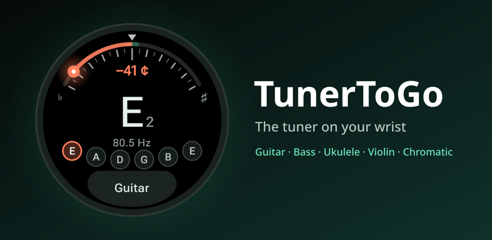
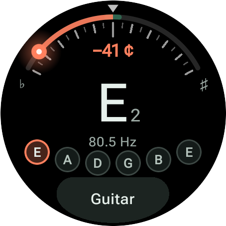
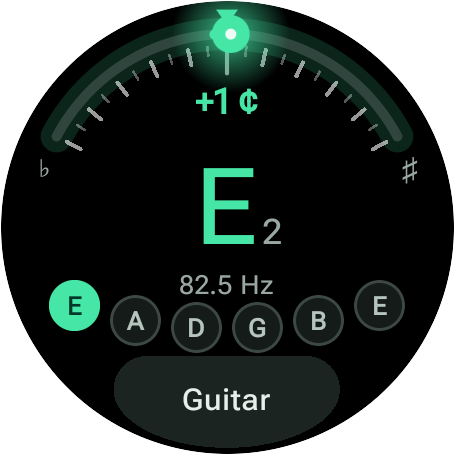
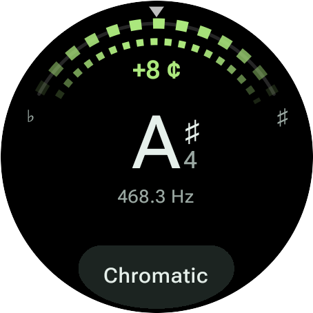
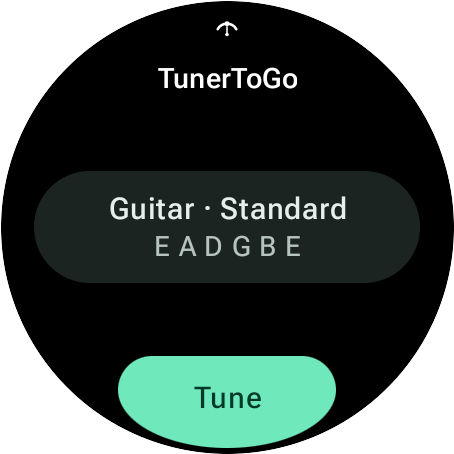
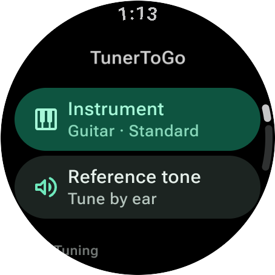
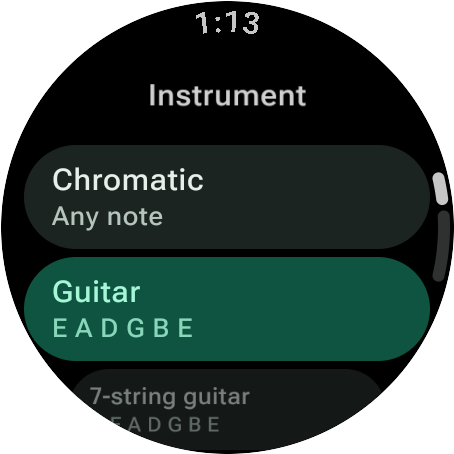
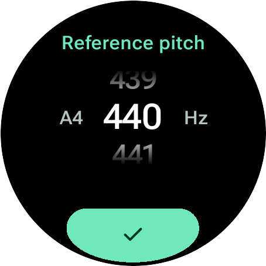

<p align="center">
  
</p>

<p align="center">
  <a href="https://play.google.com/store/apps/details?id=net.devemperor.tunertogo"></a>
  <a href="https://github.com/DevEmperor/TunerToGo/actions/workflows/ci.yml"></a>
  
  <a href="LICENSE"></a>
</p>

<p align="center">
  <b>The tuner on your wrist.</b><br>
  TunerToGo turns a Wear OS watch into a precise instrument tuner – with automatic string
  detection for guitar, bass, ukulele and strings, a chromatic mode, and a strobe.
</p>

<p align="center">
  <a href="https://play.google.com/store/apps/details?id=net.devemperor.tunertogo"></a>
</p>

<p align="center">
  <a href="#install">Install</a> ·
  <a href="#how-it-works">How it works</a> ·
  <a href="#faq">FAQ</a> ·
  <a href="#development">Development</a>
</p>

---

## Highlights

- **Precise** – pitch detection from 25 Hz (low B of a 5-string bass) to 4.5 kHz with
  sub-cent resolution, measured on the watch in real time.
- **Calm display** – the needle is smoothed, single-frame slips (pick attack, octave jumps)
  are ignored, and the last note stays on screen for a moment after the string stops.
- **Instrument mode** – the tuner finds the string you play and measures against it, even
  when it is far off. Turn the crown (or tap the dial) to lock onto one string; tuned strings
  get a tick.
- **Feel it** – a short vibration when the note is in tune, so your eyes can stay on the pegs.
- **Gauge or strobe** – a colour-coded gauge, or a strobe that stands still when you hit
  the note.
- **For musicians** – reference pitch 400–480 Hz (442 Hz orchestra, 415 Hz baroque),
  transposition for B♭, E♭ and F instruments, English (B), German (H) or solfège note names,
  sharps or flats.
- **Reference tone** to tune by ear, on watches with a speaker.
- **Tile** to start tuning with one tap; works standalone, no phone app needed.
- **Private** – no internet permission at all; nothing is recorded or stored.
- **Pay once** – no ads, no in-app purchases, no subscriptions, no account.
- English and German.

## Screenshots

<table>
  <tr>
    <td align="center"><br><sub><b>Instrument mode</b> – low E, 41 cents flat</sub></td>
    <td align="center"><br><sub><b>In tune</b> – green, with a tap on the wrist</sub></td>
    <td align="center"><br><sub><b>Strobe</b> – stands still when in tune</sub></td>
    <td align="center"><br><sub><b>Tile</b> – one tap to tune</sub></td>
  </tr>
  <tr>
    <td align="center"><br><sub><b>Menu</b> – instrument and settings</sub></td>
    <td align="center"><br><sub><b>Instruments</b> – and their tunings</sub></td>
    <td align="center"><br><sub><b>Reference pitch</b> – with the crown</sub></td>
    <td></td>
  </tr>
</table>

## Instruments and tunings

| Instrument | Tunings |
| --- | --- |
| Guitar | Standard (E A D G B E), E♭ Standard, D Standard, Drop D, Drop C, DADGAD, Open D, Open G, Open E, Open C |
| 7-string guitar | Standard (B E A D G B E), Drop A |
| Bass | Standard (E A D G), E♭ Standard, Drop D, 5-string (B E A D G), 6-string (B E A D G C) |
| Ukulele | Standard (re-entrant g C E A), Low G, D tuning, Baritone (D G B E) |
| Violin · Viola · Cello | G D A E · C G D A · C G D A |
| Double bass | Orchestra (E A D G), Solo (F♯ B E A) |
| Mandolin | G D A E |
| Banjo | Open G (g D G B D), Double C, Open D |
| Chromatic | Any note – also for wind instruments and voice |

## Install

**From Google Play** on the watch, or from the Play Store on the paired phone – a one-time
purchase without ads or in-app purchases, which keeps the development going.
Requires Wear OS 3 or newer and a watch with a microphone.

**Build it yourself:** the source is open, so you are welcome to build and install your own
copy (see [Development](#development)); on the watch, enable *Developer options* and
*Wireless debugging* and run `./gradlew :app:installRelease` (signed with your debug key
when there is no `keystore.properties`).

## How it works

1. **Listening** – while the tuner screen is open, the microphone delivers 44.1 kHz audio
   (unprocessed where the watch supports it, so noise suppression can't bend the pitch).
2. **Pitch** – every 23 ms the last 93 ms of sound go through the
   [YIN algorithm](https://doi.org/10.1121/1.1458024) (de Cheveigné &
   Kawahara, 2002), computed with an FFT. YIN looks for the period of the waveform rather
   than for the loudest frequency, so it still finds a low E whose fundamental a small watch
   microphone barely picks up. Parabolic interpolation gives sub-cent precision, and a
   strict octave check catches the rare case where the second harmonic fools it.
3. **Reading** – quiet or noisy frames are dropped, single-frame outliers ignored, a new
   note is followed once it is heard twice in a row. A median and a light exponential
   average smooth the value; the current note or string only changes when another one is
   clearly closer, so the display never flickers at a boundary.
4. **In tune** – once the pitch stays within the chosen range (±3 cents by default) for a
   quarter of a second, the dial turns green and the watch taps your wrist.

The signal processing is plain Kotlin without native code and is covered by unit tests with
synthetic sines, plucked strings (Karplus-Strong), missing fundamentals and noise.

## FAQ

<details>
<summary><b>The tuner shows the wrong string.</b></summary>

When a string is tuned down by more than a few semitones, its pitch can be closer to the
neighbouring string. Turn the crown (or rotating bezel) to lock the tuner onto the string you
are tuning – it steps through *Auto*, every string and back to *Auto*. On watches without a
crown, tap the middle of the dial instead. A locked string has an amber ring.
</details>

<details>
<summary><b>It doesn't react to my instrument.</b></summary>

Hold the watch closer to the sound hole or the amplifier and let the note ring. In a quiet
room or with soft instruments, set *Sensitivity* to *High*; in a noisy room, set it to
*Low*. If the mic icon shows a crossed-out microphone, another app (e.g. the assistant) is
using it.
</details>

<details>
<summary><b>Why is there no reference tone on my watch?</b></summary>

The entry only appears on watches with a speaker (or a connected Bluetooth speaker or
headphones). Watch speakers can't play low notes, so the tone is built from harmonics –
your ear still hears the right pitch.
</details>

<details>
<summary><b>Why these permissions?</b></summary>

| Permission | Used for |
| --- | --- |
| Microphone | Hearing your instrument, only while the tuner is open |
| Vibration | The tap when a note is in tune (can be turned off) |

TunerToGo has no internet permission. See the [privacy policy](PRIVACY.md); questions to
<contact@devemperor.net>.
</details>

## Development

Kotlin, Jetpack Compose for Wear OS (Material 3) and ProtoLayout for the tile.

```bash
./gradlew :app:testDebugUnitTest   # unit tests: pitch detection, note names, tunings, smoothing
./gradlew :app:lintDebug           # Android lint, including the Wear OS checks
./gradlew :app:assembleDebug       # debug APK (net.devemperor.tunertogo.debug)
./gradlew :app:bundleRelease       # release bundle for Google Play
```

Release builds are signed with the upload key named in an untracked `keystore.properties`
in the repository root (see [`keystore.properties.example`](keystore.properties.example)).
Without it, the release APK is signed with the debug key, which is fine for testing on a
watch but not accepted by Play.

| Path | What it does |
| --- | --- |
| `app/src/main/kotlin/…/audio/` | Microphone capture, FFT, YIN pitch detector, reference tone |
| `app/src/main/kotlin/…/tuner/` | Smoothing and string/note logic (`TunerProcessor`), view model, haptics |
| `app/src/main/kotlin/…/music/` | Pitch math, note naming, instruments and tunings |
| `app/src/main/kotlin/…/ui/` | Compose screens: dial, strobe, menu, pickers |
| `app/src/main/kotlin/…/tile/` | The tile |
| `fastlane/metadata/android/` | Play Store listing in English and German |
| `docs/play-console.md` | Publishing checklist with the answers for every Play Console form |
| `art/`, `tools/` | Icon and feature graphic sources, screenshot and asset scripts |

**Testing without an instrument:** the debug build accepts a synthetic input instead of the
microphone, and a deep link into any screen:

```bash
adb shell am start -n net.devemperor.tunertogo.debug/net.devemperor.tunertogo.MainActivity \
    --ef demo_hz 80.5 --ef demo_drift 3 --es routes menu,reference_pitch
```

`tools/capture-screenshots.sh` takes the store screenshots on a *Wear OS Large Round*
emulator, `tools/render-store-assets.sh` turns them into the store and README graphics.

## Credits

- Icons: [Material Symbols](https://github.com/google/material-design-icons) by Google,
  Apache License 2.0.
- Pitch detection after A. de Cheveigné and H. Kawahara, *YIN, a fundamental frequency
  estimator for speech and music*, J. Acoust. Soc. Am. 111 (4), 2002.
- Google Play and the Google Play logo are trademarks of Google LLC.

## License

[Apache License 2.0](LICENSE) – see also [NOTICE](NOTICE).
